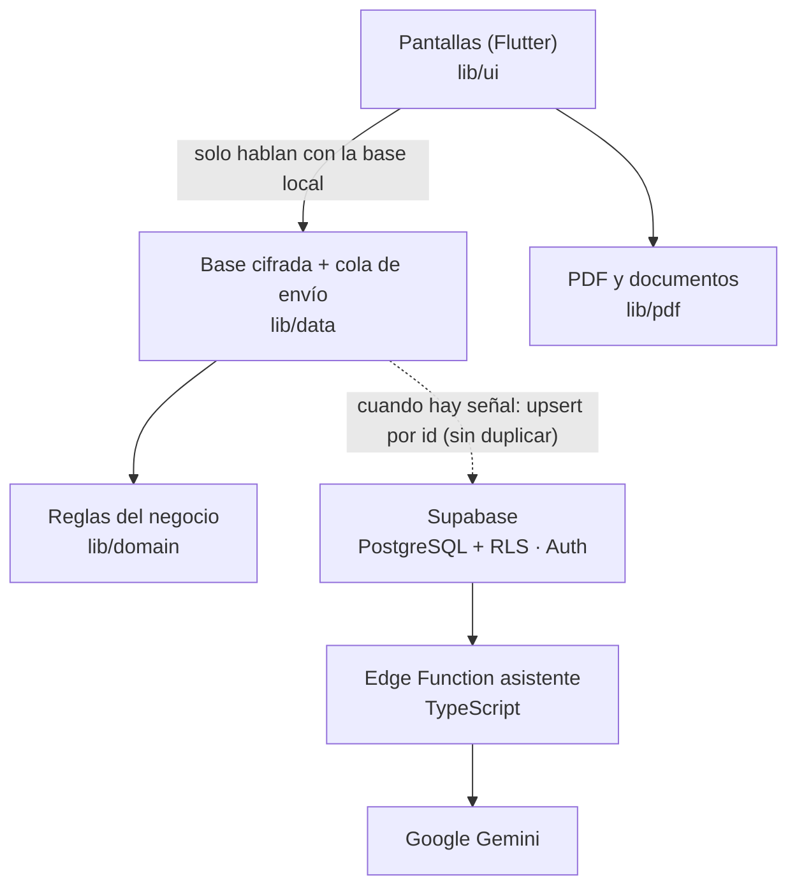

# VERTEX AI Pyme

**El cuaderno de la tienda, ahora en el celular. Funciona sin señal.**

App para las MiPymes de Casanare: tiendas de barrio y de pueblo y **22 tipos de negocio** (panadería, frutas, carnicería, droguería, ferretería, agro, ropa, celulares, restaurante, peluquería, taller, transporte, hospedaje y más), presentada en **CreaTIC Casanare 2026** por el equipo **VERTEX TECH**.

**Pruébala ya (iPhone, Android o PC, en el navegador):** https://ingdavidortegaf-lab.github.io/vertex-ai-pyme/. Para instalarla en iPhone o Android, ver [docs/INSTALAR_EN_IPHONE_Y_ANDROID.md](docs/INSTALAR_EN_IPHONE_Y_ANDROID.md).

Lleva ventas, fiados, inventario, cobros, documentos e informes para el contador. **Todo se guarda primero en el celular, cifrado**, y se sincroniza con la nube cuando vuelve la conexión, sin perder ni duplicar nada.

---

## Qué hace

| Área | Funciones |
|---|---|
| **Caja** | Ventas de contado y fiadas, gastos y abonos; venta con productos, **código de barras** (cámara o lector USB) y **gramera** (kilos y libras) |
| **Medios de pago** | Efectivo, Nequi, Daviplata, Bancolombia, Bre-B y tarjetas; **pago dividido** (parte Nequi, parte efectivo); **cierre de caja** con cuadre del efectivo |
| **Clientes y cartera** | Nombre completo o razón social, celular, **cédula o NIT** (con dígito de verificación DIAN) y **correo**; cliente nuevo **desde la venta**; saldo de cada cliente, **cuenta de cobro en PDF** con días de mora y antigüedad (0-30, 31-60, 61-90, +90) y cobro por WhatsApp |
| **Seguimiento (CRM)** | Clientes que hace rato no vienen, mejores clientes, nuevos y perdidos, con mensaje de WhatsApp sugerido; solo a quien autorizó (Ley 1581) |
| **Proveedores y terceros** | Proveedores, arrendador, servicios y empleados con NIT o cédula, celular y correo; **gasto a nombre de quién se le pagó**; pedido pagado **todo, en parte (30/50/70 %) o fiado**; **Lo que debo** con vencimientos, abonos por medio de pago y aviso 3 días antes |
| **Promociones** | **Foto o video**, **imagen lista para el estado** (logo y precios) y **texto redactado con IA**: 5 estilos y temporada (quincena, viernes negro, Navidad); funciona sin señal |
| **Pagos fijos** | Arriendo, luz, agua, internet y los propios del negocio: día de pago, aviso de lo que vence y pago que queda como gasto |
| **Inventario y servicios** | Existencias calculadas a partir de los movimientos, productos por reponer, pedido sugerido al proveedor y **servicios sin inventario** |
| **Documentos** | Comprobantes, cotizaciones, cuentas de cobro, pedidos e informes en **PDF con logo y número único** (`CV-`, `CT-`, `CC-`, `PD-`, `IN-`, `AU-` para autorizaciones), archivados en el equipo |
| **Informes para el contador** | Semanal, quincenal y mensual: estado de resultados, flujo de caja, gastos por concepto, cartera, inventario y libro de movimientos |
| **A la medida del negocio** | Registro guiado al empezar; la app se adapta (productos, servicios, fiado, gramera, códigos de barras, pedidos) y **los ejemplos de cada casilla son del tipo de negocio** (licorera, droguería, ferretería…) |
| **Avisos** | Notificaciones en el celular: producto agotado o por acabarse, cobros vencidos, pagos a proveedores por vencer, meta cumplida |
| **Asistente** | Responde sin señal con los datos del celular; con señal, la IA (Gemini) da consejos y redacta promociones usando solo totales o productos y precios, nunca nombres de personas |

> No es factura electrónica DIAN, y cada documento lo dice. Los datos quedan estructurados para conectarse con un proveedor tecnológico autorizado.

---

## Cómo está hecha

| Pieza | Tecnología |
|---|---|
| App: Android 12+, Windows y **web** (iPhone con Safari); iPhone nativo listo para compilar en Mac | **Flutter 3.50 / Dart** |
| Base de datos en el navegador | **SQLite compilada a WebAssembly** (`sqflite_common_ffi_web`) |
| Base de datos en el dispositivo | **SQLite cifrada con SQLCipher (AES-256)**; la clave va en el almacén seguro del sistema |
| Backend | **Supabase**: PostgreSQL 17 con **RLS por empresa**, Auth y una Edge Function |
| IA | **Google Gemini**, llamada solo desde la Edge Function (**TypeScript/Deno**); la clave es un secreto del servidor |
| PDF | Paquetes `pdf` y `printing`: se generan en el dispositivo, sin internet |



**Offline-first:**
- Cada registro nace con un UUID.
- Se guarda junto con su entrada en la cola en **una sola transacción**.
- Un motor de sincronización sube la cola cada 30 s o cuando vuelve la red, con reintentos que esperan cada vez más.
- Los conflictos entre celulares se resuelven **campo por campo**; las ventas y el inventario solo se agregan.

---

## Organización del código

| Carpeta | Qué contiene |
|---|---|
| `lib/ui/` | Pantallas |
| `lib/domain/` | Reglas del negocio (lógica pura): cuenta de cobro FIFO, conflictos, códigos de barras, avisos, pagos, textos legales, promociones y seguimiento de clientes |
| `lib/data/` | Base local cifrada, cola y sincronización, conexión con Supabase |
| `lib/pdf/` | Generación y archivo de PDF, informes contables |
| `supabase/` | `supabase_schema.sql` (tablas, RLS, triggers) y `functions/asistente` (IA) |
| `test/` | **128 pruebas automáticas**, incluida una caída de red a mitad del envío |
| `docs/base_de_datos/` | Base SQLite de ejemplo y consultas SQL probadas (SQLite, PostgreSQL y MySQL); [cómo mostrarla](docs/base_de_datos/LEEME_BASE_DE_DATOS.md) |
| `docs/` | Manual, auditoría, política de datos (Ley 1581), licencias, [pagos y modelo de negocio](docs/PAGOS_Y_MODELO_DE_NEGOCIO.md) y guías de exposición |

Cada carpeta de código trae un `LEEME.md` corto. La explicación completa está en [`docs/COMO_ESTA_CONSTRUIDO.txt`](docs/COMO_ESTA_CONSTRUIDO.txt) y en [`docs/exposicion/`](docs/exposicion/00_LEAME_PRIMERO.md).

---

## Ejecutarlo

**Requisitos (todo gratis):** Flutter estable, Git y el Android SDK. Para Windows, además, Visual Studio Build Tools con C++ y el "Modo de programador".

```powershell
flutter pub get
flutter analyze
flutter test                 # 128 pruebas
flutter run -d windows       # en el PC, modo solo local (sin nube)
flutter run                  # en un celular Android conectado
```

En VS Code, abre `ABRIR_EN_VISUAL_STUDIO_CODE.code-workspace` y presiona **F5**.

**Con nube:** la dirección y la clave pública de Supabase entran al compilar con `--dart-define` (o `--dart-define-from-file=dart_defines.json`, que **no** está en el repositorio):
```powershell
flutter run --dart-define=SUPABASE_URL=https://TU-PROYECTO.supabase.co --dart-define=SUPABASE_ANON_KEY=TU_CLAVE_PUBLICA
```
Sin esos valores la app funciona completa en modo local.

### Supabase (plan gratuito)
1. Crea un proyecto en supabase.com.
2. En **SQL Editor**, pega `supabase/supabase_schema.sql` y ejecuta **Run**.
3. Asistente con IA (opcional):
   ```powershell
   npx supabase functions deploy asistente
   npx supabase secrets set GEMINI_API_KEY=TU_CLAVE GEMINI_MODEL=<modelo gratuito vigente>
   ```
   La clave de la IA vive solo como secreto de Supabase. **Nunca** se usa la clave `service_role` en la app.

### Compilar
```powershell
flutter build apk --release --dart-define-from-file=dart_defines.json      # Android
flutter build windows --release --dart-define-from-file=dart_defines.json  # Windows
```

---

## Seguridad y datos personales
- Base del celular cifrada con AES-256.
- Solo HTTPS.
- Claves de usuario con hash.
- Bloqueo tras 5 intentos fallidos y cierre de sesión a los 30 minutos sin uso.
- RLS en PostgreSQL: cada empresa ve solo sus datos.
- Claves fuera del código.
- **Ley 1581 de 2012:** formatos oficiales de la convocatoria: aviso de privacidad, casilla **sin premarcar** con **enlace visible** a la política (se abre sin internet), enlace a www.casanare.gov.co y **Anexo 3** de autorización para cada cliente, en PDF o por WhatsApp. Ver [`docs/AVISO_PRIVACIDAD_Y_AUTORIZACION.md`](docs/AVISO_PRIVACIDAD_Y_AUTORIZACION.md). La MiPyme es responsable de los datos; la Gobernación de Casanare es encargada. Ver [`docs/POLITICA_TRATAMIENTO_DATOS.md`](docs/POLITICA_TRATAMIENTO_DATOS.md).

## Estado y pendientes
Probado:
- 128 pruebas automáticas;
- en un celular Android real: modo avión y sincronización con Supabase sin duplicados;
- versión de Windows compilada y ejecutada;
- versión web publicada y probada en el navegador del computador.

Pendiente, con el detalle en [`docs/AUDITORIA.md`](docs/AUDITORIA.md):
- factura electrónica DIAN con un proveedor autorizado;
- cifrado de la base en Windows;
- roles de vendedor y administrador;
- probar la versión web en un iPhone real;
- activar la IA en la nube (secreto `GEMINI_API_KEY` en Supabase).

## Propiedad intelectual y licencias
© 2026 Equipo VERTEX TECH (José David, Carlos Andrés y Ángel Elías Ortega Fuentes). **Todos los derechos reservados.**

Según las bases de CreaTIC Casanare 2026, la Gobernación de Casanare recibe una licencia de uso gratuita e indefinida, y el equipo conserva la propiedad intelectual. Ver la licencia de cada componente de terceros, todos de código abierto, en [`docs/LICENCIAS.md`](docs/LICENCIAS.md).

Contacto: contacto@vertextechco.online
